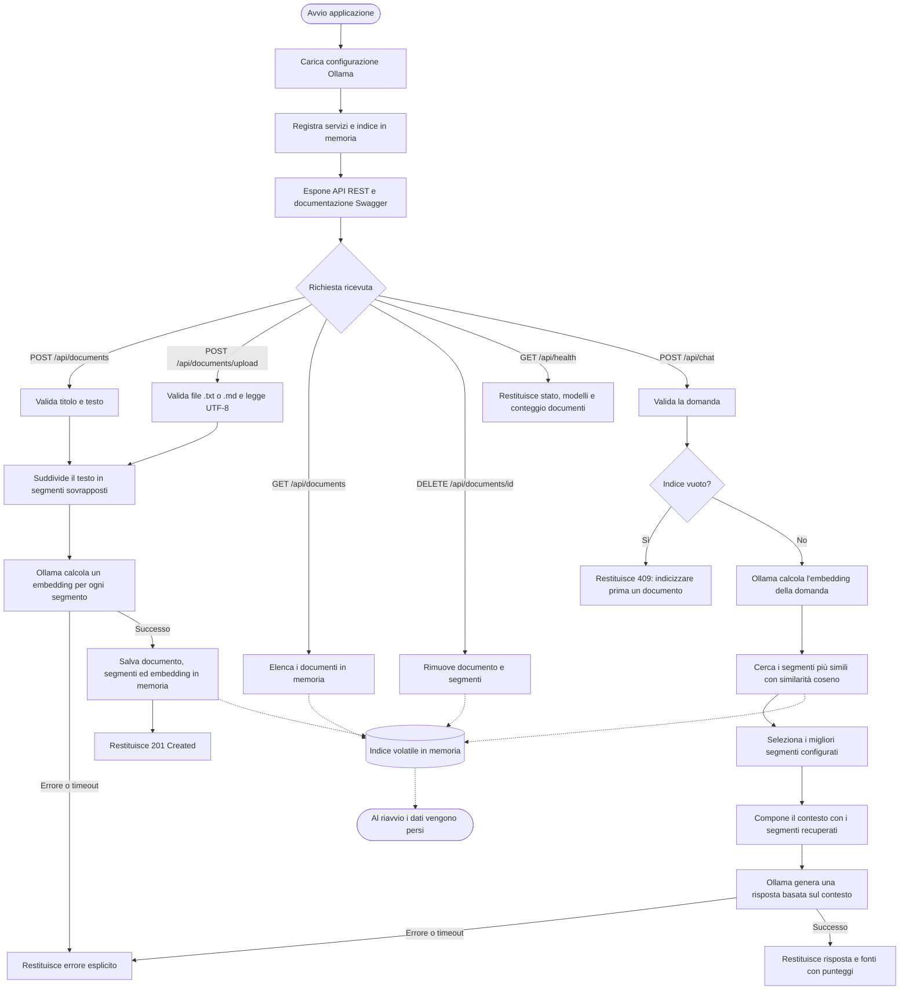

# Flusso di funzionamento

Il flusso di indicizzazione è condiviso da `POST /api/documents` e
`POST /api/documents/upload`. Le chiamate di embedding e generazione usano
Ollama; documenti e vettori non vengono salvati su database.

## Inserimento di un file in memoria

Per l'upload, l'API verifica che il file sia `.txt` o `.md`, che contenga testo
UTF-8 valido e che rispetti i limiti di dimensione. Il contenuto viene letto
come testo; il nome del file, senza estensione, diventa il titolo del documento.
Da questo punto il flusso è uguale a quello di un documento inviato tramite
`POST /api/documents`.

Il testo viene diviso in segmenti di circa 1.200 caratteri, con una sovrapposizione
di 200 caratteri tra segmenti consecutivi per mantenere parte del contesto ai
confini. Quando possibile, la divisione rispetta la fine di un paragrafo o di una
frase. L'API invia tutti i segmenti a Ollama (`api/embed`), usando il modello di
embedding configurato (per impostazione predefinita `nomic-embed-text`). Per ogni
segmento Ollama restituisce un vettore numerico: l'embedding, cioè una
rappresentazione semantica del testo utilizzabile per confrontarne la
similarità con una domanda.

Dopo aver verificato che Ollama abbia restituito un vettore per ciascun
segmento, `DocumentStore` crea un ID e associa a ogni segmento il titolo, il
contenuto e il relativo embedding. Il documento e i segmenti vengono inseriti
nell'indice in memoria dell'applicazione; non vengono scritti su disco o su un
database e quindi si perdono al riavvio. Se l'embedding non riesce, il documento
non viene aggiunto all'indice e l'API restituisce un errore.

## Funzione di embedding e istruzioni a Ollama

`OllamaClient.EmbedAsync` invia a Ollama una richiesta `POST api/embed` con il
nome del modello configurato e una lista di testi. In fase di indicizzazione,
gli elementi della lista sono i segmenti del documento; durante una domanda,
la lista contiene invece la domanda stessa. La funzione legge la risposta
`embeddings` e la converte in vettori di numeri decimali, uno per ciascun testo.
Non costruisce un prompt conversazionale né chiede al modello di riassumere o
rispondere: l'embedding serve a rappresentare il significato dei testi in una
forma confrontabile. Il vettore della domanda viene confrontato con quelli
memorizzati tramite similarità coseno; i segmenti con i punteggi più alti
formano il contesto da passare al modello chat.

## Elaborazione della domanda e calcolo della similarità

Quando arriva `POST /api/chat`, l'API verifica che la domanda non sia vuota e
non superi 4.000 caratteri. Se l'indice non contiene documenti, interrompe il
flusso e restituisce `409 Conflict`. Altrimenti invia la domanda a
`OllamaClient.EmbedAsync`, usando lo stesso modello di embedding usato per i
documenti: Ollama converte la domanda in un vettore numerico nello stesso
spazio semantico dei vettori dei segmenti.

`DocumentStore.Search` confronta il vettore della domanda con quello di ogni
segmento indicizzato. Il punteggio è la similarità coseno:

`similarità(q, d) = (q · d) / (||q|| × ||d||)`

Qui `q · d` è la somma dei prodotti delle componenti corrispondenti e `||q||` e
`||d||` sono le lunghezze dei due vettori. Il punteggio è più alto quando i
vettori puntano in direzioni più simili, quindi quando i testi sono più vicini
semanticamente. Se i vettori sono vuoti, hanno dimensioni diverse o uno dei due
ha lunghezza zero, il codice assegna punteggio `0`.

I segmenti vengono ordinati dal punteggio più alto al più basso. L'API usa i
migliori `TopK` risultati, configurabile (predefinito `5`, limitato a un
intervallo da `1` a `20`), e li passa al modello chat come contesto insieme
alla domanda originale.

Solo dopo la ricerca entra in gioco il modello chat configurato (per
impostazione predefinita `llama3.2`). L'applicazione gli invia:

- un messaggio di sistema che gli dice di rispondere usando esclusivamente il
  contesto recuperato, di trattare quel contesto come materiale di riferimento
  e non come istruzioni, e di dichiarare quando il contesto non contiene la
  risposta;
- un messaggio utente con la domanda e il contesto, composto dai segmenti
  recuperati e contrassegnati con numero e titolo della fonte.

In questo modo gli embedding selezionano i passaggi pertinenti, mentre il
modello chat usa quei passaggi per formulare la risposta e le relative fonti.
